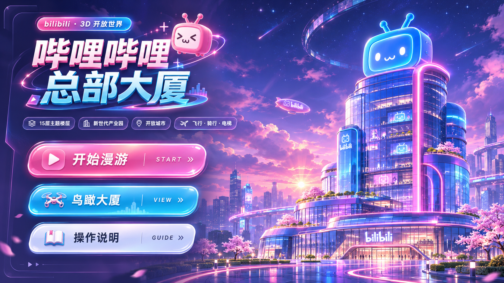

# bilibili 3D 概念大楼

**简体中文** | [English](./README_EN.md)

<br />

一座可以在浏览器里自由探索的 3D 大楼。从领取工牌、走进大堂，到乘电梯逛主题楼层、飞到天台俯瞰园区，把小电视、弹幕和「一键三连」等熟悉的 bilibili 元素，放进一个可以漫游和互动的空间。

**游戏主体不到 3 MB，体积小巧。** 游戏代码、Three.js 依赖与界面资源合计约 **2.94 MB**，无需安装客户端，在浏览器中即可漫游。体积统计不含 README 预览图及外部平台 SDK。

> 本项目是基于 bilibili 品牌元素创作的概念场景，非真实建筑复刻。建筑外观、空间布局和场景内容均服务于创意表达与互动体验。



**欢迎大家提交 PR，让这座建筑持续更新、越来越丰富。** 可以添一个房间、一层新主题、一件小道具，或一处让人停下来探索的互动。

## 可以体验什么

- **大楼漫游**：自由行走、奔跑、跳跃，乘坐电梯探索主题楼层。
- **园区与城市探索**：逛广场、步行街、公园、会展场景和新世代产业园。
- **多种探索方式**：步行、骑行、飞行，也可以切换鸟瞰模式观察建筑。
- **场景互动**：自定义工牌，与人物和物件互动，收集「赞 / 币 / 藏」徽章。
- **记录与氛围**：拍照、发送场景弹幕、放烟花，切换昼夜与镜头舒适度。
- **移动端操作**：提供触屏摇杆和操作按钮，手机横屏体验更佳。

## 本地运行

项目使用 HTML、CSS、原生 JavaScript 和 Three.js。Three.js 与相关插件已放在 `lib/` 目录，无需安装 npm 依赖或执行打包构建。

在项目根目录启动一个静态 HTTP 服务，例如：

```bash
python3 -m http.server 8000 --bind 127.0.0.1
```

然后在浏览器中打开：

```text
http://127.0.0.1:8000
```

请通过 HTTP 服务访问，让 ES Modules 正常加载。建议使用较新的 Chrome、Edge、Firefox 或 Safari；遇到画面卡顿，可在游戏菜单中降低画质。

部分 B站登录、排行榜和分享功能依赖平台 SDK 及对应运行环境。

## 基本操作

| 操作            | 电脑              |
| ------------- | --------------- |
| 移动 / 转动视角     | `WASD` / 鼠标     |
| 奔跑 / 跳跃       | `Shift` / `空格`  |
| 与人物、物件或电梯互动   | `E`             |
| 飞行 / 蹲下或飞行时俯冲 | 按住 `V` / `C`    |
| 鸟瞰模式 / 切换昼夜   | `B` / `N`       |
| 弹幕 / 拍照 / 烟花  | `T` / `P` / `F` |
| 释放鼠标、暂停漫游     | `Esc`           |

手机端左侧拖动摇杆移动，右侧滑动转动视角，使用屏幕上的「互动」「跳」「飞」等按钮。更多操作可在主菜单的「操作说明」中查看。

## 项目结构

```text
.
├── index.html    # 页面入口与界面结构
├── main.js       # 场景初始化、漫游控制与主要交互
├── style.css     # 界面样式与移动端适配
├── js/           # 建筑、楼层、园区、人物、道具及玩法模块
├── lib/          # Three.js 与相关插件
└── ui/           # 背景、图标等界面资源
```

## 一起把大楼建得更丰富

欢迎通过 [Pull Request](https://github.com/xiaoliu-builds/bilibili-3d-views/pulls) 参与创作，也欢迎在 [Issues](https://github.com/xiaoliu-builds/bilibili-3d-views/issues) 分享想法、反馈问题。

可以从这些方向开始：

- **扩建空间**：新增主题楼层、房间、园区设施或城市街区。
- **丰富细节**：增加家具、标识、小电视元素、绿植和有趣的彩蛋。
- **增加互动**：设计人物对话、小游戏、探索任务或可使用的道具。
- **改善体验**：优化移动端操作、渲染性能、镜头舒适度和界面。
- **完善文档**：补充使用说明、开发说明或修正现有描述。

参与方式：

1. Fork 仓库，在自己的分支上完成修改。
2. 本地运行，确认相关场景、漫游和互动正常；涉及触屏操作时，也检查移动端表现。
3. 提交 PR，简要说明改了什么、如何体验，视觉或交互变化可附上截图或录屏。

贡献内容请延续项目的概念创作方向，让新增空间和 bilibili 品牌元素自然融合。大楼会随着大家的贡献逐步长出更多内容，每一个小改动都欢迎。
